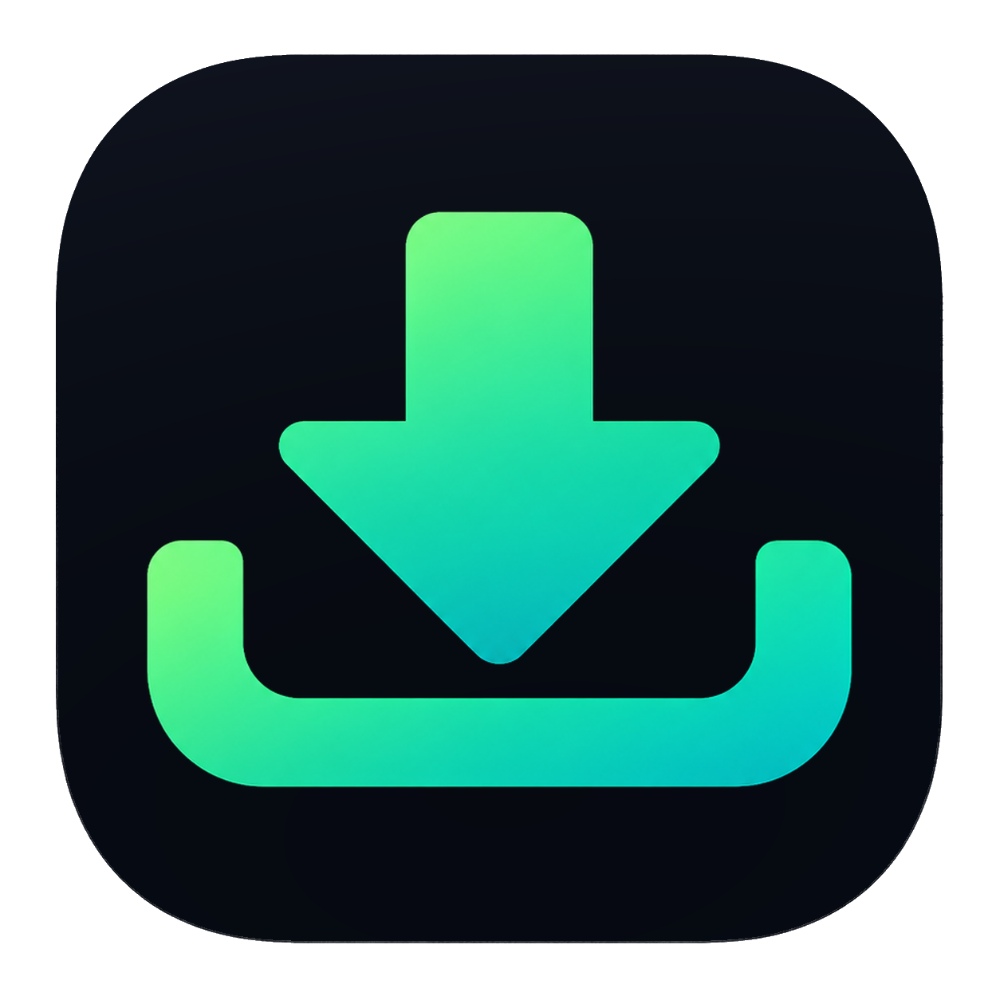
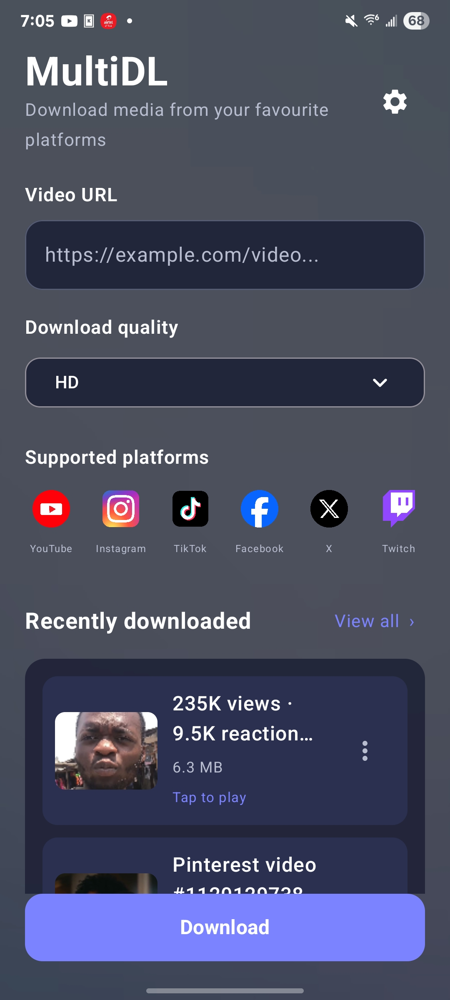
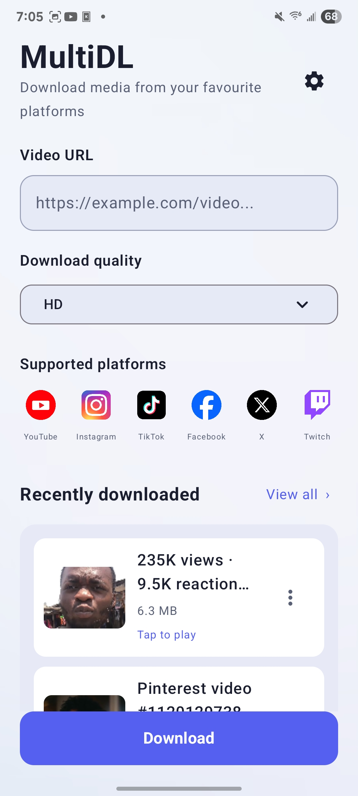
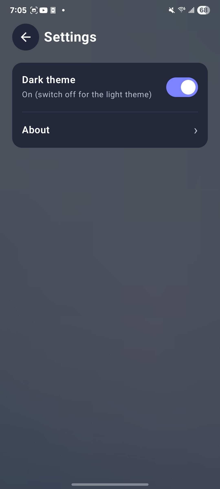
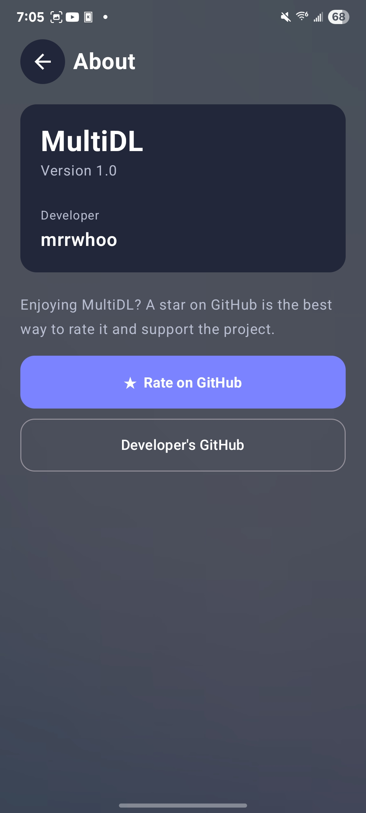
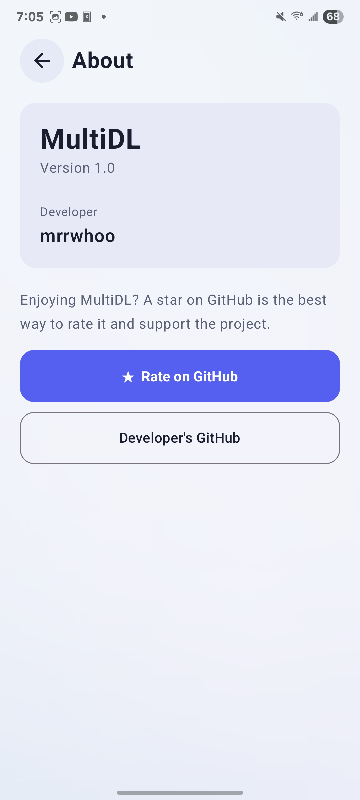

<div align="center">


## MultiDL

### Free video and audio downloader. 

Paste a link, pick a quality, download. Everything runs on your device: no server, no account, no ads.

[](https://github.com/mrrwhoo1/MultiDL/releases/latest)
[](https://github.com/mrrwhoo1/MultiDL/releases)
[](https://github.com/mrrwhoo1/MultiDL/stargazers)
[](#install-on-android)
[](#build-from-source-android)
[](https://github.com/yt-dlp/yt-dlp)
[](https://github.com/yt-dlp/yt-dlp/blob/master/supportedsites.md)

[**Download the APK**](https://github.com/mrrwhoo1/MultiDL/releases/latest) &nbsp;|&nbsp; [Features](#features) &nbsp;|&nbsp; [Build from source](#build-from-source-android) &nbsp;|&nbsp; [Roadmap](#roadmap)

</div>

---

## Contents

- [About](#about)
- [Screenshots](#screenshots)
- [Features](#features)
- [Download](#download)
- [Install on Android](#install-on-android)
- [Supported sites](#supported-sites)
- [Quality modes](#quality-modes)
- [Permissions and privacy](#permissions-and-privacy)
- [Build from source (Android)](#build-from-source-android)
- [Run the PC prototype (Python and Flet)](#run-the-pc-prototype-python-and-flet)
- [Roadmap](#roadmap)
- [Releasing a new version](#releasing-a-new-version)
- [Known limitations](#known-limitations)
- [Contributing](#contributing)
- [Credits](#credits)
- [License](#license)
- [Disclaimer](#disclaimer)

## About

MultiDL is a simple, friendly front end for [yt-dlp](https://github.com/yt-dlp/yt-dlp). You paste a video link, choose **HD**, **Data Saver** or **Audio**, and MultiDL downloads it straight to your phone. The download engine (yt-dlp) and the media tools (FFmpeg) are bundled inside the app, so nothing is sent to a server of mine and there is nothing to sign up for.

The project started as a Python desktop app and is now growing into a family of apps that share the same idea:

| Version | Technology | Status |
|---|---|---|
| **Android app** | Kotlin, Jetpack Compose, embedded Python (yt-dlp) | Available, see [Download](#download) |
| **Linux**  | Flutter | In development |
| **Windows exe** | Flutter | In development |


## Screenshots

<div align="center">





</div>

## Features

- Download video and audio from the sites supported by [yt-dlp](https://github.com/yt-dlp/yt-dlp) (see [Supported sites](#supported-sites)).
- Three quality modes: **HD**, **Data Saver** and **Audio (MP3)**. .
- Runs entirely on your phone. No server, no account, no ads.
- Live progress bar while a download is running.
- Files are saved to `Downloads/MultiDL` and named after the video title.
- Tap a file to play it; rename or delete it from the menu on each item.
- Your downloads are still listed after you uninstall and reinstall the app (after you allow media access).

## Download

<!-- After you publish the first release, nothing here needs to change: the links below always point at the newest release. -->

| Platform | Status | Get it |
|---|---|---|
| Android 7.0+ | Available | [**Latest APK on GitHub Releases**](https://github.com/mrrwhoo1/MultiDL/releases/latest) |
| Linux | Planned | Coming soon |
| Windows | Later | Coming later |


## Install on Android

1. Open the [latest release](https://github.com/mrrwhoo1/MultiDL/releases/latest) on your phone and download the `.apk` file from **Assets**.
2. Open the downloaded file. If Android asks, allow your browser or file manager to **install unknown apps**.
3. Tap **Install**. Android may show a warning because the app does not come from the Play Store.
4. Open MultiDL and, when asked, allow access to photos, videos and audio. This is only used to list the files MultiDL has downloaded.

Requirements: Android 7.0 or newer on a 64-bit phone (`arm64-v8a`, which is almost every modern phone, or `x86_64`). Older 32-bit-only phones are not supported.


## Supported sites

MultiDL can download from any site that [yt-dlp supports](https://github.com/yt-dlp/yt-dlp/blob/master/supportedsites.md), which is well over a thousand. The app highlights these:

| YouTube | Instagram | TikTok | Facebook | X (Twitter) | Twitch |
|---|---|---|---|---|---|

Sites change their pages all the time, so a site that works today can break tomorrow until yt-dlp (and therefore MultiDL) is updated. Private, friends-only and login-only videos cannot be downloaded.

## Quality modes

| Mode | What you get | Output |
|---|---|---|
| **HD** | The best video and the best audio available, merged into one file | `.mkv` (or the site's original format if the site already serves one combined file) |
| **Data Saver** | The smallest video, with low-bitrate audio in the video's original language, for slow or limited data | `.mkv` (or the original format), with `(Data Saver)` added to the file name |
| **Audio** | Sound only, converted to MP3 at 192 kbps | `.mp3` |

`.mkv` can hold almost any video and audio combination without re-encoding, so merging is fast. A few older players cannot open `.mkv`; VLC and most modern players can. Highly suggest you download a supported media player.

## Permissions and privacy

| Permission | Why it is needed |
|---|---|
| `INTERNET` | To download the media you ask for and to check GitHub for a new app version. |
| `READ_MEDIA_VIDEO`, `READ_MEDIA_AUDIO` (Android 13 and newer) | To list the videos and audio MultiDL saved earlier. Android hides files from an app after it is reinstalled unless it has this permission. |
| `READ_EXTERNAL_STORAGE` (Android 12 and older) | The same reason as above, on older versions of Android. |

MultiDL has no accounts, no ads and no tracking libraries. Its only network traffic is to the sites you download from, and a small request for [`version.json`](version.json) on GitHub to see whether a new version exists.

## Build from source (Android)

The Android project lives in [`android_app/`](android_app/).

**You need**

- JDK 17 or newer
- The Android SDK with platform 35 (install it with Android Studio, or the command-line tools)
- Python 3.13 on your `PATH`. The build uses it to install yt-dlp into the app (via [Chaquopy](https://chaquo.com/chaquopy/)). If the build cannot find it, point Chaquopy at your interpreter with `buildPython` in the `chaquopy { }` block of `android_app/app/build.gradle.kts`.
- An internet connection for the first build (Gradle, Compose, Chaquopy's Python runtime, yt-dlp and FFmpeg are all downloaded)

**Build a debug APK**

```bash
git clone https://github.com/mrrwhoo1/MultiDL.git
cd MultiDL/android_app

# Tell Gradle where your Android SDK is (skip if ANDROID_HOME is already set)
echo "sdk.dir=$HOME/Android/Sdk" > local.properties

./gradlew assembleDebug
```

The APK is written to `app/build/outputs/apk/debug/app-debug.apk`.

**Install it on a connected phone** (USB debugging on):

```bash
adb install -r app/build/outputs/apk/debug/app-debug.apk
```

You can also open the `android_app/` folder in Android Studio and press **Run**.

**Build a signed release APK**

A release build must be signed before Android will install it.

```bash
./gradlew assembleRelease
# creates app/build/outputs/apk/release/app-release-unsigned.apk

# One-time: create your signing key and KEEP IT SAFE (never commit it)
keytool -genkeypair -v -keystore multidl-release.jks -alias multidl \
        -keyalg RSA -keysize 2048 -validity 10000

# Sign the APK (apksigner lives in your SDK's build-tools folder)
$ANDROID_HOME/build-tools/<version>/apksigner sign \
        --ks multidl-release.jks --out MultiDL-1.0.apk \
        app/build/outputs/apk/release/app-release-unsigned.apk
```

> [!IMPORTANT]
> Always sign updates with the **same key**. If you lose it or use a different one, phones will refuse to install new versions over the old app.

**Good to know**

- Only `arm64-v8a` and `x86_64` are built (the FFmpeg library has no 32-bit build), and the minimum is Android 7.0 (API 24).
- yt-dlp is installed with `pip` at build time without a pinned version, so each build bundles the newest yt-dlp. Pin it in `app/build.gradle.kts` (for example `install("yt-dlp==<version>")`) if you need reproducible builds.
- The app is a single `MainActivity.kt` (screens and UI), `UpdateChecker.kt` (update notice), `FfmpegBridge.kt` (lets Python call FFmpeg) and `android_download_handler.py` (the yt-dlp download logic), under `android_app/app/src/main/`.

## Run the PC prototype (Python and Flet)

The first version of MultiDL is a desktop app written in Python with [Flet](https://flet.dev). It still works and lives in [`src/`](src/), but it will be replaced by the Flutter desktop app (see the [Roadmap](#roadmap)). It currently targets Linux (opening a finished download uses `xdg-open`).

**You need** Python 3.10 or newer and **FFmpeg** installed (yt-dlp uses it to merge video and audio and to make MP3 files).

```bash
# Debian / Ubuntu
sudo apt install ffmpeg python3-venv

git clone https://github.com/mrrwhoo1/MultiDL.git
cd MultiDL

python3 -m venv .venv
source .venv/bin/activate
pip install -r src/requirements.txt

cd src
python main.py
```

Downloads are saved to `~/Downloads/multidl` as `.mp4` (video) or `.mp3` (audio).

## Roadmap

- [x] **Android app v1.0**: HD, Data Saver and Audio downloads, progress, history with thumbnails, themes, in-app update notice.
- [ ] **Linux desktop app**: a new desktop version of MultiDL.
- [ ] **Windows build**: compiled from the same Flutter desktop app
- [ ] **Better downloads**: more sites tested and tuned, and a smoother experience on slow connections
- [ ] **Pause/Resume**: The ability to stop and resume downloads at will.
- [ ] **Mutiple Downloads**: Allowing users to download mutiple videos/audio at the same time.
- [ ] **Playlist Downloads**: Specifically for youtube, Users will just paste a playlist link and it autimatically downloads and saves with the original playlist name.
- [ ] **App continuity**: Downloads working in the background, currently it works sometimes and the other half it throws a donwload link error. 

Ideas and requests are welcome: please [open an issue](https://github.com/mrrwhoo1/MultiDL/issues).

## Releasing a new version

This section is for maintainers. The app finds out about new versions by reading [`version.json`](version.json) from the `main` branch.

1. Increase `versionCode` (a whole number that always goes up) and `versionName` in `android_app/app/build.gradle.kts`.
2. Build and sign the release APK (see [Build from source](#build-from-source-android)).
3. Create a GitHub Release (for example the tag `v1.1`) and attach the signed APK.
4. Edit `version.json` with the same `versionCode` and `versionName`, new `releaseNotes`, and a `downloadUrl` that starts with `https://github.com/` (the app ignores any other address). Push it to `main` **after** the release exists, because that push is what triggers the update notice.

```json
{
  "versionCode": 2,
  "versionName": "1.1",
  "downloadUrl": "https://github.com/mrrwhoo1/MultiDL/releases/latest",
  "releaseNotes": "What changed in this version."
}
```

## Known limitations

- Videos that need a login (private, friends-only, group or age-gated posts) cannot be downloaded.
- Sites change often. If one stops working, it usually needs a newer yt-dlp, which ships in the next app update.
- Facebook and some other sites are less reliable than YouTube.
- On Android 7 to 9, finished files are kept in the app's own folder instead of the public Downloads folder, because the Downloads copy needs Android 10 or newer.
- Some older players cannot play `.mkv` files.
- There is no 32-bit Android build.

## Contributing

Bug reports, ideas and pull requests are very welcome.

**When you report a bug, please include**

- your phone model and Android version, and the MultiDL version (Settings, then About)
- which site and quality mode you used, and the shape of the link (for example `facebook.com/reel/...`); please do not post private links
- the full red error text shown in the app

**To contribute code:** fork the repo, create a branch, make your change, and open a pull request. For the Android app, open `android_app/` in Android Studio.

If MultiDL is useful to you, a star on GitHub is the nicest way to say thanks.

## Credits

- [yt-dlp](https://github.com/yt-dlp/yt-dlp): the download engine that does the real work
- [FFmpeg](https://ffmpeg.org/) and the community-maintained [ffmpeg-kit](https://github.com/ffmpegkit-maintained): merging video and audio and converting to MP3 on Android
- [Chaquopy](https://chaquo.com/chaquopy/): runs Python (and so yt-dlp) inside the Android app
- [Jetpack Compose](https://developer.android.com/jetpack/compose): the Android user interface
- [Flet](https://flet.dev): the interface of the PC prototype

## License

MultiDL is licensed under the **GNU General Public License v3.0 (GPL-3.0)**.

Copyright © 2026 Maron H. Chilomo.

You may use, study, modify, and redistribute this project under the terms of the GPL-3.0. If you distribute modified versions of GPL-covered code, you must comply with the licence's applicable conditions, including providing the corresponding source code as required.

See the [`LICENSE`](LICENSE) file for the full licence text and [`NOTICE`](NOTICE) for the project copyright and third-party licensing notice.

### Third-party components

MultiDL includes open-source software developed by other projects, including yt-dlp, FFmpeg/FFmpegKit, Chaquopy, and AndroidX/Jetpack Compose. These components retain their respective copyrights and are subject to their own licence terms. The GPL-3.0 licence for MultiDL does not replace or override those terms.

Please review the applicable third-party licences before redistributing the application or its bundled components.

## Disclaimer

MultiDL is a tool for saving media you have the right to download, such as your own uploads, public-domain material, Creative Commons content, or content you have permission to keep. You are responsible for following the laws of your country and the terms of service of each site. The developer is not affiliated with YouTube, Instagram, TikTok, Facebook, X, Twitch or any other platform mentioned here, and their names and logos belong to their owners.

<div align="center">

Made by [mrrwhoo](https://github.com/mrrwhoo1)

</div>
